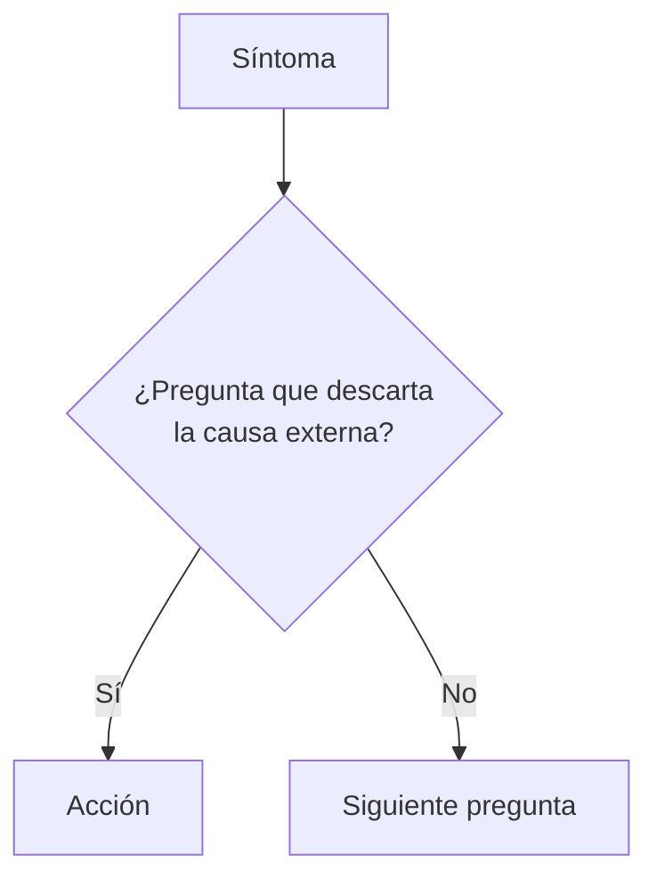

# [Problema tal como lo describe el usuario]

| | |
| --- | --- |
| **Aplica a** | Sistema operativo, versión, tipo de equipo o aplicación |
| **Nivel** | N1 / N2 |
| **Tiempo estimado** | |
| **Riesgo** | Bajo / medio / alto, y qué se puede perder |
| **Requiere** | Permisos, herramientas, acceso remoto |

## Síntoma

Qué ve el usuario, con el mensaje de error exacto entre comillas.

## Causas más comunes

1. La más probable.
2. ...

## Diagnóstico



## Solución paso a paso

### 1. Nombre del paso

Instrucción concreta.

```cmd
comando
```

Resultado esperado: ...

> Captura sugerida: `capturas/NN-nombre.png`

## Verificación

- [ ] Prueba que confirma que quedó resuelto.
- [ ] El usuario confirma.

## Si no se resuelve

Escalar a [equipo] con:

- Dato 1
- Dato 2

## Nota para el ticket

```text
Síntoma:
Diagnóstico:
Acciones:
Resultado:
Estado:
```
